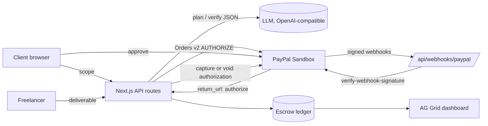

# Escrow Agent

**The AI only pays when the work actually passes.**

Escrow Agent is milestone escrow for freelance gigs. A client and freelancer paste the scope they agreed on. An AI agent turns it into milestones with objective acceptance criteria. Each milestone is funded through the PayPal Orders v2 API with `intent=AUTHORIZE`, so the money is held on the client's PayPal account, not spent. When the freelancer delivers, the agent checks the deliverable against every criterion. If it passes, the client approves and the authorization is captured. If it fails, the agent builds a dispute evidence pack and the hold can be voided.

## Features

- AI milestone planner: scope in, 2 to 5 milestones out, with budget split to the cent and testable criteria
- PayPal Orders v2: create order (AUTHORIZE), buyer approval redirect, authorize, capture authorization, void authorization, with `PayPal-Request-Id` idempotency keys
- AI deliverable verifier: per-criterion pass/fail with evidence and confidence; server re-derives the verdict so the model cannot pass a milestone with a failing criterion
- Human approval gate: the agent recommends, only the client releases money
- Dispute evidence pack: timeline, failed criteria, PayPal references, recommendation
- AG Grid escrow ledger: every order, hold, verification, capture, void and webhook, filterable and paginated
- PayPal webhooks with signature verification via `verify-webhook-signature`, deduplicated by event id
- One-click Render deploy via `render.yaml`
- Mock mode: no keys needed, full flow runs end to end

## Architecture



State machine per milestone:

```
draft -> awaiting_approval -> funded -> submitted -> verified -> released
                                  ^         |
                                  |         v
                               (resubmit) rejected -> disputed -> (void) draft
```

| Layer | File |
| --- | --- |
| PayPal client (OAuth, orders, authorize, capture, void, webhook verify) | `lib/paypal.ts` |
| AI planner and verifier, mock fallbacks | `lib/ai.ts` |
| Escrow state machine and dispute pack | `lib/escrow.ts` |
| Validation (zod), rate limiting, origin checks | `lib/validation.ts`, `lib/ratelimit.ts`, `lib/http.ts` |
| UI and AG Grid ledger | `app/page.tsx`, `app/Ledger.tsx` |

## Run it

Requires Node 20+.

```bash
npm install
cp .env.example .env   # optional; leave empty for mock mode
npm run dev            # http://localhost:3000
npm test               # unit + flow tests
```

### Mock mode (no keys)
Leave `PAYPAL_CLIENT_ID`, `PAYPAL_CLIENT_SECRET` and `LLM_API_KEY` empty. PayPal calls return deterministic `MOCK*` ids and the approval step redirects straight back to the app. The AI uses a deterministic keyword planner and verifier. The header pills show `PayPal: mock` and `AI: mock`.

### Sandbox mode
1. Create a REST app at https://developer.paypal.com (Sandbox). Copy Client ID and Secret into `.env`.
2. Use a sandbox personal account (Developer Dashboard, Testing Tools, Sandbox Accounts) to approve payments.
3. Optional webhooks: expose the app over HTTPS, add a webhook pointing at `/api/webhooks/paypal` for `PAYMENT.AUTHORIZATION.CREATED`, `PAYMENT.CAPTURE.COMPLETED`, `PAYMENT.AUTHORIZATION.VOIDED`, and set `PAYPAL_WEBHOOK_ID`.
4. Set `LLM_API_KEY` (and optionally `LLM_BASE_URL`, `LLM_MODEL`) for any OpenAI-compatible chat completions endpoint with JSON mode.

Note: PayPal authorizations have a 3 day honor period and are valid up to 29 days; fund each milestone when work on it starts.

### Deploy on Render
`render.yaml` defines a web service. Secrets are declared with `sync: false` so they are entered in the Render dashboard, never committed.

## Security

- Secrets only from environment; `.env*` gitignored, `.env.example` has empty placeholders; secrets are never logged or sent to the client
- Webhooks rejected unless PayPal confirms the signature; in mock mode webhooks are always rejected
- zod validation on every input, size limits on bodies, strict id format, http(s)-only deliverable URLs
- Per-IP rate limiting per route, same-origin check on mutations, security headers
- Prompt-injection hardening: deliverable text is framed as untrusted data and the server never trusts the model's top-level verdict
- Strict state machine: money cannot be captured unless the milestone is verified
- Scanned with gitleaks

Production notes: the store is in-memory for the demo; swap `lib/store.ts` for Postgres and add authentication per party before real use.

## License
MIT
